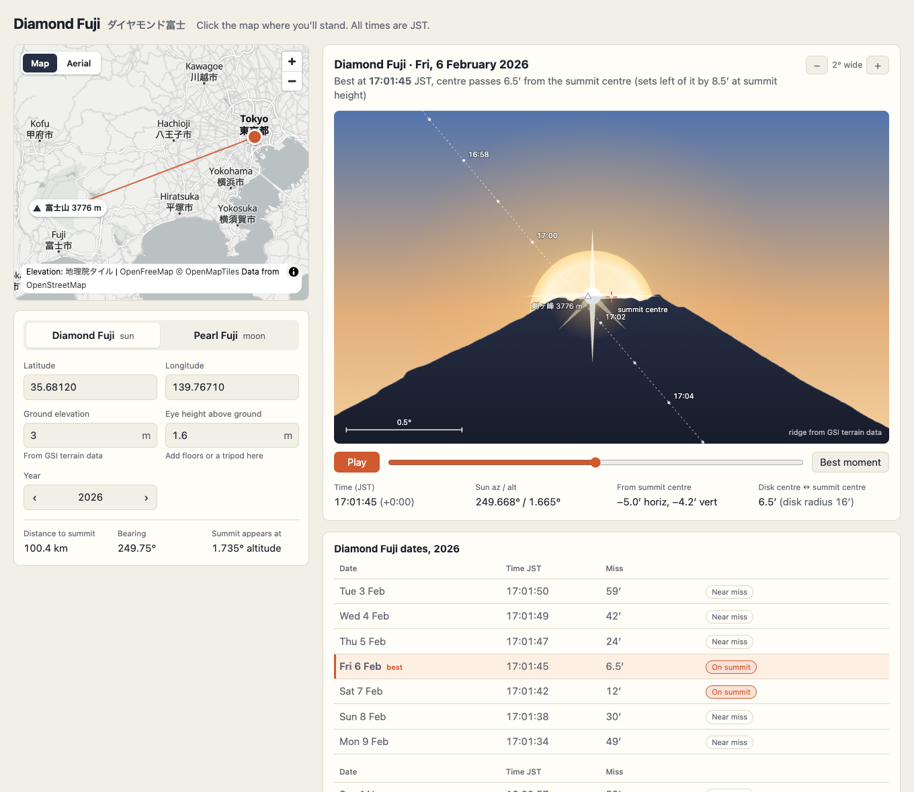
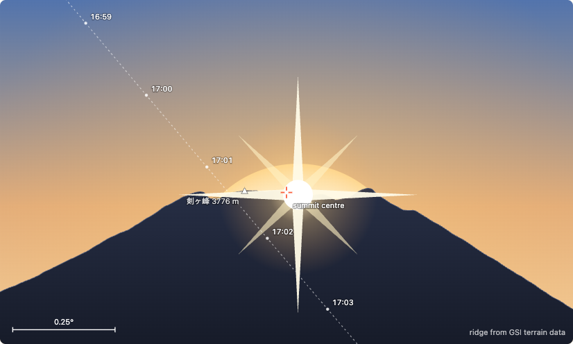
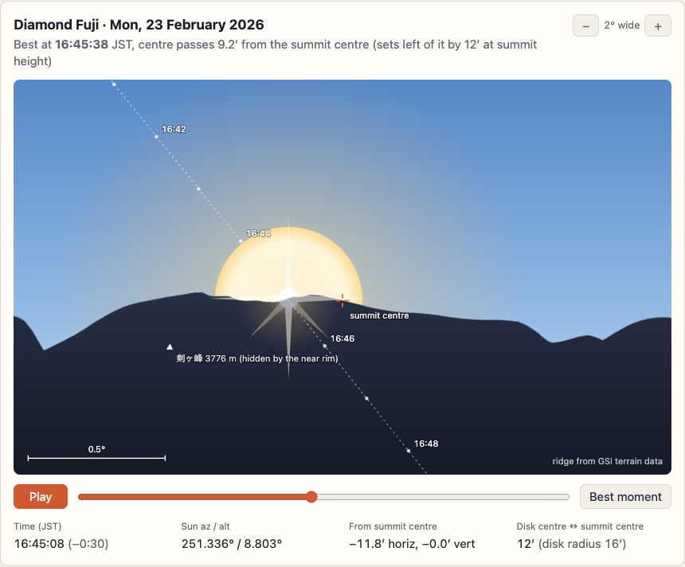

# Diamond Fuji calculator

Click where you'll stand on the map, set your elevation, and pick a year. The app lists every day the
sun (Diamond Fuji, ダイヤモンド富士) or the full moon (Pearl Fuji, パール富士) sits on Mt. Fuji's summit.
It also draws the disk's exact position against Fuji's skyline, minute by minute.

Everything runs in Docker; nothing is installed on the host.



| | |
|---|---|
|  |  |
| **The "diamond":** zoomed in on Tokyo Station's best day (6 Feb 2026), 45 s after closest approach. The dotted track has minute ticks. | **Pearl Fuji:** the full moon setting onto the summit at dawn on 3 Apr 2026, seen from Den-en-chōfu. The moon's phase is drawn to scale. |



**Close range:** from Panorama-dai at Lake Yamanaka, 17 km away, the crater's near rim stands higher in the sky than Kengamine itself. The crosshair marks the middle of the summit, on the rim; the triangle marks Kengamine, hidden behind it.

## Run

```sh
docker compose up --build app     # http://127.0.0.1:4778
```

No API keys or accounts are needed. If you change dependencies, run `docker compose up --build -V app`. The `-V` gives the container a fresh
`node_modules` volume.

```sh
docker compose run --rm app npm test          # vitest
docker compose run --rm app npm run typecheck
docker compose --env-file .env.local --profile prod up --build prod   # nginx build on :4778
```

## Map and terrain data

Everything comes from free, keyless tile servers:

| What | Source | Used for |
|---|---|---|
| Map | [OpenFreeMap](https://openfreemap.org) vector tiles, OpenStreetMap data, Positron style | picking where you stand |
| Aerial | [GSI seamless photo](https://maps.gsi.go.jp/development/ichiran.html) (地理院タイル) | picking where you stand |
| Elevation | [GSI DEM10B elevation tiles](https://maps.gsi.go.jp/development/demtile.html) (標高タイル) | ground elevation, Fuji's ridge |

The map is only for picking a spot; no terrain is read from it. `src/components/MapPicker.tsx` drops the
parts of Positron that crowd a small map: buildings, road names, route shields, airports and transit lines.
Minor roads, paths and neighbourhood names appear once you zoom in. The map is drawn with
[MapLibre](https://maplibre.org), which loads after the rest of the page (about 300 KB gzipped, plus its
worker).

The elevation tiles are 256 px PNGs that store metres in their RGB values. The app decodes them in the browser
(`src/maps/elevation.ts`):

- **Ground elevation** fills in when you click the map. GSI has no data for the sea, so a spot on the water
  reads as sea level.
- **Fuji's real ridge line** is built from 13 terrain cross-sections. The cross-sections near the crater use
  full-resolution tiles (about 8 m pixels); the ones across the flanks use coarser tiles. That's about a dozen tiles,
  roughly 1.2 MB, the first time; later moves mostly reuse them.

GSI's data covers Japan, which is everywhere Fuji can be seen from. If the tiles can't be fetched, you type
the elevation and the app draws the modelled profile.

OpenFreeMap has no keys or usage limits; it runs on donations. If it ever goes away, any host of
OpenMapTiles-schema vector tiles works with the same style. GSI's tiles need only the attribution, which the
map shows.

## Deploy (Cloudflare Workers)

The site is static: Workers static assets serve `dist/` (`wrangler.jsonc`), with no Worker code.
Deploying is the one thing that runs on the host, not in Docker, so wrangler can use your normal
browser login.

```sh
npm install            # after dependency changes; host node_modules, separate from the container's
npx wrangler login     # once
npm run deploy         # build + wrangler deploy
```

## How it works (`src/lib`)

- **What counts as "on the summit".** Diamond Fuji is the sun sitting in the *middle* of the summit (MLIT
  Kanto: 頂上の真ん中). The target is the direction of the crater centre (大内院, 35.36354° N 138.73062° E),
  at the height of the visible ridge in that direction. The ridge comes from GSI terrain when available
  and from a modelled crater otherwise. Kengamine (剣ヶ峰, 3776.24 m, GSI) is the high point on the
  south-west rim, about 410 m from the centre, and is marked separately. From close or side-on viewpoints,
  aiming at Kengamine instead would put the best day a day early or late.
- **Where the summit appears.** Its direction and altitude come from WGS84 ECEF→ENU geometry, which
  includes Earth's curvature. Terrestrial refraction is added with k = 0.13.
- **Sun and moon positions.** These are topocentric positions from
  [astronomy-engine](https://github.com/cosinekitty/astronomy). Astronomical refraction uses the
  Saemundsson formula, scaled for the lower air pressure at your elevation.
- **Finding each crossing.** For each day, `SearchAltitude` brackets when the body passes the
  summit's altitude, rising if Fuji is east of you and setting if it's west. A root-finder then
  pins down the refracted crossing.
- **How close it passes.** From that crossing, the app works out the disk centre's closest approach
  to the summit.
- **Ratings.**
  - *Dead centre*: within 3′ of the summit.
  - *On summit*: the summit point is inside the disk.
  - *Near miss*: within 1°.
- **Checked against published data** (in `src/lib/lib.test.ts`):
  - NAOJ sunset times and azimuths for Tokyo: within 1 minute.
  - Enoshima Ōhashi, around Apr 5 and Sep 7: both match exactly.
  - Yokohama Ōsanbashi, Mar 9–10 (MLIT Kanto): matches.
  - The Lake Yamanaka sequence through February, from Nagaike to Asahigaoka to Panorama-dai. Panorama-dai
    lands on Feb 23, the published date, with terrain data.
  - Den-en-chōfu (MLIT Kanto, Feb 17–18) comes out on Feb 15 at the station. MLIT's coordinates for that
    neighbourhood were placed by eye.

Not modelled: whether hills, buildings or trees between you and Fuji block the view, weather, or the day-to-day variation in refraction near the horizon.
Expect timing to be off by up to a minute either way.

From close range (Lake Yamanaka, for example), the crater's near rim stands higher in the sky than
Kengamine, which is behind it. The target sits on that near rim, because that is where the sun actually
touches the mountain.
