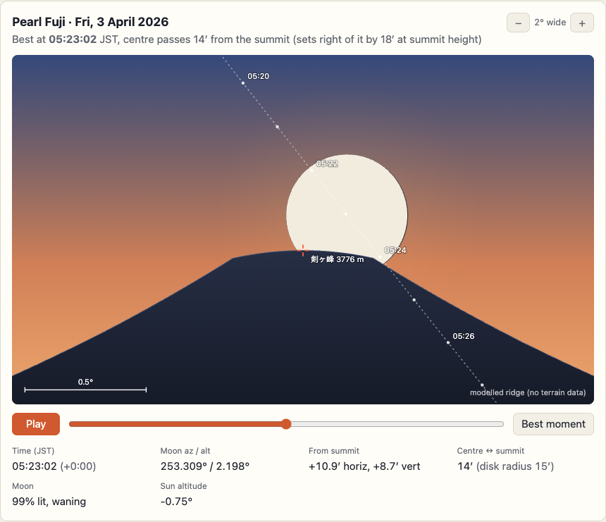

# Diamond Fuji calculator

Click where you'll stand on a Google map, set your elevation, and pick a year. The app lists every day the
sun (Diamond Fuji, ダイヤモンド富士) or the full moon (Pearl Fuji, パール富士) sits on Mt. Fuji's summit.
It also draws the disk's exact position against Fuji's skyline, minute by minute.

Everything runs in Docker; nothing is installed on the host.


| | |
|---|---|
|  |  |
| **The "diamond":** zoomed in on Tokyo Station's best day (6 Feb 2026), 45 s after closest approach. The dotted track has minute ticks. | **Pearl Fuji:** the full moon setting onto the summit at dawn on 3 Apr 2026, seen from Den-en-chōfu. The moon's phase is drawn to scale. |


**Close range:** from Panorama-dai at Lake Yamanaka, 17 km away, the crater's near rim stands higher in the sky than Kengamine itself. The crosshair marks Kengamine, hidden behind the rim.

These screenshots use the modelled ridge. With the Elevation API enabled, the app draws the real one.

## Run

```sh
cp .env.example .env.local        # then fill in VITE_GOOGLE_MAPS_API_KEY
docker compose up --build app     # http://127.0.0.1:4778
```

The key needs **Maps JavaScript API** enabled, with `http://127.0.0.1:4778/*` as an allowed referrer.
Enabling the **Elevation API** on the same key turns on three features:

- ground elevation fills in automatically when you click the map
- Fuji's real ridge line, built from 10 terrain cross-sections, replaces the modelled cone
- a line-of-sight check tells you whether hills in between hide the summit

Without it, you type the elevation and the app draws the modelled profile.

If you change dependencies, run `docker compose up --build -V app`. The `-V` gives the container a fresh
`node_modules` volume.

```sh
docker compose run --rm app npm test          # vitest
docker compose run --rm app npm run typecheck
docker compose --env-file .env.local --profile prod up --build prod   # nginx build on :4778
```

## How it works (`src/lib`)

- **Summit.** The target is Kengamine (剣ヶ峰): 35.36083° N 138.72750° E, 3776.24 m (GSI).
- **Where the summit appears.** Its direction and altitude come from WGS84 ECEF→ENU geometry, which
  includes Earth's curvature. Terrestrial refraction is added with k = 0.13.
- **Sun and moon positions.** These are topocentric positions from
  [astronomy-engine](https://github.com/cosinekitty/astronomy). Astronomical refraction uses the
  Saemundsson formula, scaled for the lower air pressure at your elevation.
- **Finding each crossing.** For each day, `SearchAltitude` brackets when the body passes the
  summit's altitude, rising if Fuji is east of you and setting if it's west. A root-finder then
  pins down the refracted crossing.
- **How close it passes.** From that crossing, the app works out the disk centre's closest approach
  to the summit.
- **Ratings.**
  - *Dead centre*: within 3′ of the summit.
  - *On summit*: the summit point is inside the disk.
  - *Near miss*: within 1°.
- **Checked against published data** (in `src/lib/lib.test.ts`):
  - NAOJ sunset times and azimuths for Tokyo: within 1 minute.
  - MLIT Kanto's Diamond Fuji dates for Yokohama Ōsanbashi (Mar 9–10) and Den-en-chōfu (Feb 17–18).
  - The Lake Yamanaka sequence, moving from Nagaike to Asahigaoka to Panorama-dai through February.

Not modelled: buildings, trees, weather, or the day-to-day variation in refraction near the horizon.
Expect timing to be off by up to a minute either way.

From close range (Lake Yamanaka, for example), the crater's near rim stands higher in the sky than
Kengamine, which is behind it. The drawing shows this, and the sun disappears behind the near rim a few
seconds earlier than the listed time.
